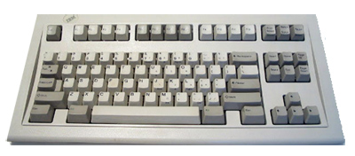
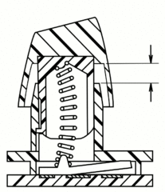

Nostalgia bucklespring keyboard sound
=====================================

Copyright 2016-2025 Ico Doornekamp

This project emulates the sound of my old faithful IBM Model-M space saver
bucklespring keyboard while typing on my notebook, mainly for the purpose of
annoying the hell out of my coworkers.




Bucklespring runs as a background process and plays back the sound of each key
pressed and released on your keyboard, just as if you were using an IBM
Model-M. The sound of each key has carefully been sampled, and is played back
while simulating the proper distance and direction for a realistic 3D sound
palette of pure nostalgic bliss.

To temporarily silence bucklespring, for example to enter secrets, press
ScrollLock twice (but be aware that those ScrollLock events _are_ delivered to
the application); same to unmute.  There is a Pause entry on the tray menu
which does the same thing. The keycode for muting can be changed with
the `-m` option. Use keycode 0 to disable the mute function.

Installation
------------

[](https://repology.org/project/bucklespring/versions)

### Debian

Bucklespring is available in the latest Debian and Ubuntu dev-releases, so you can
install with

```
$ sudo apt-get install bucklespring
```

### VoidLinux

Bucklespring is available in the VoidLinux repositories, so you can install with

```
$ sudo xbps-install -S bucklespring
```

### FreeBSD

Bucklespring can be installed via package:

```
$ pkg install bucklespring
```

or built via port:

```
$ cd /usr/ports/games/bucklespring
$ make install clean
```

### Linux, building from source

To compile on debian-based linux distributions, first make sure the require
libraries and header files are installed, then simply run `make`:

Every flavour needs OpenAL and libsndfile.  `buckle-x11` needs libX11 and libXtst
on top of that, and `buckle-libinput` needs libinput, libudev and
libwayland-client.  The system tray icon needs GTK 3 and
libayatana-appindicator; it is left out when they are missing.  Building from
a git checkout rather than a release tarball also needs autoconf, automake and
pkg-config.

#### Dependencies on Debian
```
$ sudo apt-get install build-essential autoconf automake pkg-config \
    libopenal-dev libsndfile1-dev libxtst-dev \
    libinput-dev libudev-dev libwayland-dev \
    libgtk-3-dev libayatana-appindicator3-dev
```

#### Dependencies on Arch Linux
```
$ sudo pacman -S base-devel autoconf automake pkgconf openal libsndfile libxtst \
    libinput systemd-libs wayland gtk3 libayatana-appindicator
```

#### Dependencies on Fedora Linux
```
$ sudo dnf install gcc autoconf automake pkgconf openal-soft-devel \
    libsndfile-devel libX11-devel libXtst-devel \
    libinput-devel systemd-devel wayland-devel \
    gtk3-devel libayatana-appindicator-gtk3-devel
```

#### Building
```
$ ./configure
$ make
$ ./buckle-x11
```

From a git checkout, run `autoreconf -i` once before `./configure`.

There is one executable per source of key events, and `configure` builds each
one whose dependencies it finds, so the command above generally produces two:

* `buckle-x11` grabs events through X11, and so only hears keys typed within
  an X session.
* `buckle-libinput` reads the raw input devices in `/dev/input` instead, which
  is what works under a Wayland compositor and on the console.  Those devices
  are not readable by ordinary users, so this one needs the access granting
  first; see "Reading the input devices" below.

Pass `--disable-libinput` or `--disable-x11` to build just the one, and
`--enable-libinput` to insist on it rather than let a missing library quietly
turn it off.  The same goes for `--enable-tray` and `--disable-tray`.
`./configure --help` lists the rest.

#### Reading the input devices

`buckle-libinput` needs read access to `/dev/input/event*`, and running it as
root is no answer: it then no longer reaches the sound daemon of your session.
A udev rule is installed which grants that access to whoever is logged in at
the local seat, and it does nothing until you arm it:

```
$ sudo mkdir -p /etc/bucklespring
$ sudo touch /etc/bucklespring/uaccess
$ sudo udevadm trigger --subsystem-match=input --action=change
```

Read the comments in the rule before you do: that access lets any process of
yours read every keystroke on the machine, passwords typed into other
programs included.  Delete the flag file and trigger again to take it back.

#### The tray icon

Where GTK 3 and libayatana-appindicator were found at build time, buckle puts
an icon in the system tray.  Its menu is short on purpose:

```
Pause  (ScrollLock × 2)
—
Preferences
Quit Bucklespring 1.5.2~dev
```

Pause and quit are the two things worth doing in one click, and everything
else is in the preferences window that the third entry opens.  The version is
on the quit entry because the menu has no About entry to carry it.  Rolling
the mouse wheel over the icon changes the volume without opening the menu at
all.  `--no-tray` leaves the icon out for one run.

Pausing from the menu and pausing from the keyboard are the same switch, so
the menu follows along when you use the key.

The icon is a StatusNotifierItem.  KDE Plasma shows those as they are; GNOME
Shell needs an extension, `gnome-shell-extension-appindicator` on Debian.
Where nothing is listening the icon simply does not appear, and buckle carries
on regardless, as it does on a console where there is no display at all.

#### The preferences window

The volume, the clip set, the audio device and the headphone filter live here
rather than in the menu.  A menu on a tray icon travels over dbusmenu, which
carries labels and check marks rather than widgets: a volume there can only be
a ladder of radio items, a device list has to be rebuilt as a submenu every
time it changes, and the panel, not the program, decides when the menu closes.
A window has a slider and two combo boxes and none of that.  It also means
that a desktop with nothing listening for the icon still has all of it.

The running buckle puts the window up when asked:

```
$ buckle-x11 --preferences
```

That second invocation plays nothing and holds no sound device of its own.  It
asks over the session bus, where the running one answers to
`nl.zevv.Bucklespring`, and then exits; the window belongs to the program that
is already running.  The desktop file has the same thing as an action, so a
right click on the launcher offers *Bucklespring preferences*, and `pkill
-USR1 buckle-x11` does it too, for a keyboard shortcut with no dbus tooling in
it.

Closing the window leaves the clicks running; *Quit* is next to it for
stopping the program altogether.  Nothing opens it by itself: an unasked-for
window at login would be worse than no icon.

#### Starting it automatically

A systemd user unit is installed for each flavour, tied to the desktop session
rather than to login, so it stops when you log out:

```
$ systemctl --user enable --now buckle-x11
```

#### Using snap on Ubuntu (since 16.04) and other distros

```
$ sudo snap install bucklespring
$ bucklespring.buckle
```

The snap includes the OpenAL configuration tweaks mentioned in this README.
See http://snapcraft.io/ for more info about Snap packages


### MacOS

I've heard rumours that bucklespring also runs on MacOS. I've been told that
the following should do:

```
$ brew install libsndfile pkg-config autoconf automake
$ git clone https://github.com/zevv/bucklespring.git && cd bucklespring
$ autoreconf -i
$ ./configure
$ make
$ ./buckle-mac
```

Note that you need superuser privileges to create the event tap on Mac OS X.
Also give your terminal Accessibility rights: system preferences -> security -> privacy -> accessibility

If you want to use buckle while doing normal work, add an & behind the command.
```
$ sudo ./buckle-mac &
```

### Windows

[The program has been compiled](https://github.com/Matin6725/bucklespring-Windows/releases/tag/bucklespring-Windows), but it has not yet received Microsoft's security certificate. Therefore, it may be detected as a virus by some antivirus software. To view reports from some antivirus programs, you can visit [link to reports](https://www.virustotal.com/gui/file/fe4a813c39793515d726311da50b9ac5e64e6d87ab21c8a16b8980b756a4e07b?nocache=1).

For better performance and to resolve some issues, it is recommended to run the program in **Administrator** mode.


Key clips
---------

The samples live in one directory per set, under
`/usr/share/bucklespring/clips`, and the Model-M recordings this project began
with are the set named `bucklespring`. `--list-clips` says which are
installed, `--clips=NAME` picks one, and the preferences window has the same
list and switches between them while running; the samples of the old set are
dropped and the new ones load as you type. `-p PATH` still points at a
directory of clips directly, for a set that is not installed alongside the
others.

A set need not cover every key. Where it does not, `-f` falls back to a
single sample for whatever it is missing.

Clips are read with libsndfile, so a set may be `.flac`, `.wav`, `.ogg` or
`.opus`; the first of those found for a given key wins, in that order. The set
shipped here is FLAC, which is lossless and a little under half the size of
the same samples as wav; `.ogg` and `.opus` are lossy but smaller again, which
may be worth it once several sets are installed. Anything with more than one
channel is mixed down to mono, because OpenAL positions only single-channel
buffers and the left-to-right placement of the keys is most of the point.

Usage
-----

````
Usage: buckle-x11 [options]

Options:

      --clips=NAME          play the clip set NAME; --list-clips says
                            which are installed
  -d, --device=DEVICE       use OpenAL audio device DEVICE
  -f, --fallback-sound      use a fallback sound for unknown keys
  -g, --gain=GAIN           set playback gain [0..100]
      --hrtf[=WHEN]         filter for headphones, so that keys sound
                            placed around you rather than panned: on,
                            off, or auto to leave it to OpenAL
  -m, --mute-keycode=CODE   use CODE as mute key (default 0x46 for scroll lock)
  -M, --mute                start the program muted
  -c, --no-click[=LIST]     don't play a sound on mouse click; LIST
                            narrows it to some of left, middle, right,
                            side, extra, wheel, hwheel, all, none
  -h, --help                show help
      --list-clips          list the clip sets that are installed
  -l, --list-devices        list available OpenAL audio devices
      --preferences         open the preferences window of the
                            running bucklespring
  -p, --audio-path=PATH     load clips from the directory PATH
  -r, --no-repeat           stay silent while a held key auto repeats
      --repeat-delay=MS     wait MS before the first repeat, overriding
                            what the compositor or the kernel says
      --repeat-rate=HZ      make HZ repeats per second, likewise
  -s, --stereo-width=WIDTH  set stereo width [0..100]
      --no-tray             do not put an icon in the system tray
  -v, --verbose             increase verbosity / debugging
  -V, --version             show version and exit
````

The mouse clicks as well as the keyboard: the buttons, and the scroll wheel,
one click per detent.  `--no-click` silences all of it, and `--no-click=wheel`
only the wheel.

A key held down long enough to repeat clicks for every repeat.  Under Wayland
the delay and the rate are read from the compositor, which is the only thing
that knows them; on a console they come from the input device.  `--no-repeat`
goes back to one click however long the key is held.

OpenAL notes
------------


Bucklespring uses the OpenAL library for mixing samples and providing a
realistic 3D audio playback. This section contains some tips and tricks for
properly tuning OpenAL for bucklespring.

* The default OpenAL settings can cause a slight delay in playback. Edit or create
  the OpenAL configuration file `~/.alsoftrc` and add the following options:

 ````
 period_size = 32
 periods = 4
 ````

* If you are using headphones, `--hrtf` applies OpenAL's head-related transfer
  functions, so that each key sounds placed around you rather than panned
  between the ears. Left to itself OpenAL turns this on only when it believes
  it is talking to headphones, which is what `--hrtf=auto`, the default,
  leaves it to do; `--hrtf=off` refuses it even then. The preferences window
  has the same three choices and switches between them while running. To
  enable it for every OpenAL application rather than just this one:

 ````
 hrtf = true
 ````

* When starting an OpenAL application, the internal sound card is selected for output,
  and you might not be able to change the device using pavucontrol. The option to select
  an alternate device is present, but choosing the device has no effect. To solve this,
  add the following option to the OpenAL configuration file:

 ````
 allow-moves = true
 ````
